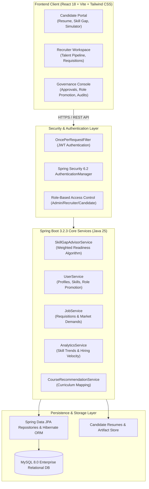

# Smart Job Market & Skill-Gap Advisor

<div align="center">

[](https://www.oracle.com/java/)
[](https://spring.io/projects/spring-boot)
[](https://react.dev/)
[](https://vitejs.dev/)
[](https://tailwindcss.com/)
[](https://www.mysql.com/)
[](https://spring.io/projects/spring-security)
[](https://jwt.io/)
[](LICENSE)

**An enterprise-grade, AI-powered talent intelligence, competency evaluation, and skill-gap advisory platform built with Spring Boot 3, Java 25, React 18, and MySQL.**

[Live Architecture](#system-architecture) • [Key Capabilities](#key-capabilities) • [Role Matrix](#role-based-access-control-rbac) • [Quick Start](#quick-start-guide) • [API Docs](#api-endpoints-reference)

</div>

---

## Executive Overview

The **Smart Job Market & Skill-Gap Advisor** is a full-stack platform designed to eliminate the disparity between engineering candidate skill proficiencies and dynamic corporate hiring requisitions. Leveraging weighted competency quantification, real-time job market analytics, AI technical and voice simulation engines, and enterprise governance workflows, the platform provides actionable insights for candidates, talent recruiters, and platform administrators.

Built adhering to modern enterprise architecture standards (including the **Infosys Enterprise Candidate & Recruiter Governance Model**), the platform provides automated ATS resume parsing, real-time ATS match scoring, one-click enterprise skill stacks, protected administrative hierarchies, and auditable talent pipelines.

---

## System Architecture



---

## Key Capabilities

### 1. Resume Ingestion & Candidate Competency Suite *(Infosys Standard)*
* **Multi-Format Document Ingestion:** Intelligent entity parser supporting PDF, DOCX, and raw text formats. Automatically extracts candidate name, verified email, telephone, tenure, degree, and claimed technical proficiencies.
* **Unrestricted Candidate Competency Management:** Candidates can add, search, categorize, and remove skills directly on their resume profile.
* **80+ Technical Competency Taxonomy:** Built-in searchable taxonomy covering Backend, Frontend, Cloud & DevOps, Databases, AI/ML, and Quality Assurance.
* **One-Click Enterprise Skill Stacks:**
  * ☕ **Full Stack Java Stack:** Java 21, Spring Boot 3, React, PostgreSQL, Docker, AWS, Microservices.
  * ☁️ **Cloud Native DevOps:** Kubernetes, Docker, AWS, Terraform, CI/CD, Git, Linux.
  * 🤖 **AI & Data Engineering:** Python, PyTorch, LangChain, RAG Architecture, PostgreSQL, FastAPI.
  * ⚛️ **Modern MERN Stack:** React, TypeScript, Node.js, Express, MongoDB, TailwindCSS.
* **Dynamic Real-Time ATS Score Recalculation:** Instant recalculation of ATS score and market readiness percentages upon adding or removing skills.
* **Skill Endorsement Request Workflow:** When profiles are locked following submission, candidates can submit auditable skill endorsement requests with justifications and certification proofs.

### 2. AI Technical & Voice Interview Simulation Engines
* **AI Technical Simulator:** Interactive simulated interview interface evaluating candidate competency across core enterprise engineering topics (e.g., Spring Boot microservices, LoRA/QLoRA parameter-efficient fine-tuning, distributed database consistency, Kubernetes ingress controllers).
* **AI Voice Interview Simulator:** Low-latency voice interview simulation with real-time audio visualization, dynamic question generation, candidate speech-to-text response logging, and instant feedback scoring.
* **Candidate Dossier Telemetry:** Full transcript archiving, technical response benchmarking, and scoring telemetry surfaced directly to recruiters and platform administrators.

### 3. Weighted Skill-Gap Advisory Engine
* **Mathematical Gap Quantification:** Differentiates core critical requirements from secondary competencies using weighted scoring formulas.
* **Target Role Benchmarking:** Analyzes gaps against standard industry job profiles (e.g., Senior Full Stack Java Developer, Cloud DevOps Architect, AI/ML Engineer).
* **Targeted Learning Recommendations:** Maps identified skill gaps directly to curated courses, industry certifications, and architectural roadmaps.

### 4. Recruiter & Executive Administrative Console
* **Infosys Governance Architecture:** Strict separation between Candidate, Recruiter, and Administrator workspaces.
* **Position Assignment & Promotion Authority:** Platform Administrators can appoint candidates to Recruiter or Administrator positions directly from the Approvals and Talent Pool tabs.
* **Protected Main Admin Security:** High-security protection for root platform administrators (`admin@skillgap.com`, `admin@smartjobadvisor.com`, etc.) preventing unauthorized demotion, deletion, or lockouts.
* **Skill Request Audit Desk:** Recruiter/Admin review portal to audit, approve, or reject candidate skill endorsement requests with automated profile synchronization.
* **Inspect Dossier Modal:** Comprehensive candidate profile viewer showcasing contact data, resume raw text, AI interview telemetry, ATS scores, and verification status.

### 5. Verified Credentials & Career Pipeline
* **Tamper-Proof Certificates:** Automated generation of verifiable technical competency certificates with unique verification IDs and export capabilities.
* **Job Application Pipeline:** Track application statuses from submission and technical review to recruiter interview and final offer.
* **Dark/Light Mode Contrast System:** High-contrast accessibility compliance across all components, badges, select dropdowns, tables, and modal dialogs.

---

## Role-Based Access Control (RBAC)

The platform implements a multi-tier governance model:

| Role Identifier | Title | Access & Permissions |
| :--- | :--- | :--- |
| `ROLE_USER` | **Candidate** | Resume ingestion, competency management, skill gap analysis, AI technical & voice simulators, certificate generator, job application tracking. |
| `ROLE_RECRUITER` | **Talent Recruiter** | Candidate talent pool access, telemetry dossier inspections, candidate approval/lockouts, skill request audits, requisition management. |
| `ROLE_MANAGER` | **Hiring Manager** | Requisition creation, interview evaluation telemetry, market trend analytics, candidate pipeline reviews. |
| `ROLE_ADMIN` | **Platform Administrator** | Full platform governance, user access approvals, role promotion (appointing recruiters/admins), system configuration, protected admin security. |
| **Protected Root Admin** | **Executive Super Admin** | Root governance account (`admin@skillgap.com`). Immutable credentials, non-demotable, protected against revocation or deletion. |

---

## Technology Stack

### Backend Architecture
* **Language & Runtime:** Java 25 LTS (with Java 21 compatibility)
* **Framework:** Spring Boot 3.2.3
* **Security:** Spring Security 6.2, JJWT (io.jsonwebtoken 0.12.5) with HMAC-SHA512
* **Persistence:** Spring Data JPA, Hibernate ORM
* **Database:** MySQL 8.0 with InnoDB engine
* **API Documentation:** OpenAPI 3.0 / Swagger UI (`/swagger-ui.html`)
* **Utilities:** Lombok, Jackson JSON, Maven

### Frontend Architecture
* **Library & Bundler:** React 18.2, Vite 5.0
* **Styling & Design System:** Tailwind CSS 3.4, PostCSS, Autoprefixer, Custom Glassmorphism
* **Icons:** Lucide React (70+ SVG icon components)
* **Visualizations:** Recharts (Radar charts, Line charts, Bar charts)
* **HTTP Client:** Axios with JWT Bearer interceptors
* **Routing:** React Router DOM v6
* **State Management:** React Context API (`AuthContext`, `ThemeContext`, `ToastContext`, `SidebarContext`)

---

## Repository Structure

```text
smart-job-market-skillgap-advisor/
├── backend/                                # Spring Boot 3 REST API Server
│   ├── src/
│   │   ├── main/
│   │   │   ├── java/com/skillgap/advisor/
│   │   │   │   ├── config/                 # Security, CORS, Swagger, WebMvc configs
│   │   │   │   ├── controller/             # REST API Controllers (User, Job, Advisor, Analytics, Auth)
│   │   │   │   ├── dto/                    # Request and Response Data Transfer Objects
│   │   │   │   ├── entity/                 # JPA Entity Models (User, Skill, Job, Course, Review)
│   │   │   │   ├── repository/             # Spring Data JPA Data Repositories
│   │   │   │   ├── security/               # JWT Token Provider, AuthFilter, UserDetails
│   │   │   │   └── service/                # Business Logic (UserService, AdvisorService, etc.)
│   │   │   └── resources/
│   │   │       ├── application.properties  # Database & Spring configuration
│   │   │       └── data.sql                # Fallback seed data
│   │   └── test/                           # Unit and Integration test suites
│   ├── mvnw.cmd / mvnw                     # Maven Wrapper binaries
│   └── pom.xml                             # Maven project dependencies
├── frontend/                               # React 18 + Vite SPA Client
│   ├── src/
│   │   ├── components/                     # Navbar, Sidebar, Breadcrumb, ProfilePhotoUploader
│   │   ├── context/                        # AuthContext, ThemeContext, ToastContext, SidebarContext
│   │   ├── hooks/                          # Custom React Hooks (useAuth, useToast, useSidebar)
│   │   ├── pages/
│   │   │   ├── Home.jsx                    # Landing page with market statistics
│   │   │   ├── Login.jsx / Register.jsx    # Authentication & onboarding
│   │   │   ├── ResumeUploader.jsx          # Candidate Resume Ingestion & Skill Suite
│   │   │   ├── InterviewSimulation.jsx     # AI Technical Interview Simulator
│   │   │   ├── VoiceInterviewSimulation.jsx# AI Voice Interview Simulator
│   │   │   ├── SkillGapAnalysis.jsx        # Weighted gap calculation & career radar
│   │   │   ├── Dashboard.jsx               # Candidate progress dashboard
│   │   │   ├── ApplicationPipeline.jsx     # Job application tracking
│   │   │   ├── AdminDashboard.jsx          # Executive Recruiter & Admin Governance Console
│   │   │   ├── MarketTrends.jsx            # High-demand skill analytics & heatmaps
│   │   │   ├── Certificates.jsx            # Tamper-proof certificate generator
│   │   │   └── Profile.jsx                 # Role-aware Candidate vs Recruiter/Admin Profile
│   │   ├── services/                       # API clients (api.js, userService.js, jobService.js)
│   │   ├── App.jsx                         # Route tree with RBAC Route Guards
│   │   └── index.css                       # Global Tailwind styles & dark mode definitions
│   ├── package.json                        # Node dependencies & scripts
│   └── vite.config.js                      # Vite server proxy & build configuration
├── database/                               # Database Scripts
│   ├── schema.sql                          # MySQL Table DDL & Foreign Key constraints
│   └── seed.sql                            # Enterprise seed data (skills, courses, jobs)
├── docs/                                   # Architecture documents and guides
├── LICENSE                                 # Apache 2.0 Open Source License
└── README.md                               # Project documentation
```

---

## Quick Start Guide

### Prerequisites
* **Java Development Kit (JDK):** Version 21 or 25 LTS installed and set in `JAVA_HOME`.
* **Node.js & npm:** Node.js v18.x or v20.x with npm v9+.
* **MySQL Server:** Version 8.0 running locally on port `3306`.
* **Git:** Version 2.30+.

---

### Step-by-Step Setup

#### 1. Clone the Repository
```bash
git clone https://github.com/omkar-kakumanu/smart-job-market-skillgap-advisor.git
cd smart-job-market-skillgap-advisor
```

#### 2. Initialize the Database
Open MySQL Workbench or your terminal and execute the database setup scripts:
```bash
mysql -u root -p < database/schema.sql
mysql -u root -p < database/seed.sql
```
*(Ensure a database named `skillgap_advisor_db` is created and populated).*

#### 3. Configure and Launch the Backend
Navigate to the `backend` folder and verify database connection details in `backend/src/main/resources/application.properties`:
```properties
spring.datasource.url=jdbc:mysql://localhost:3306/skillgap_advisor_db?useSSL=false&serverTimezone=UTC&allowPublicKeyRetrieval=true
spring.datasource.username=root
spring.datasource.password=your_mysql_password
```

Compile and start the Spring Boot application using Maven:
```bash
cd backend
./mvnw clean spring-boot:run
```
*(On Windows cmd/powershell, run `.\mvnw.cmd clean spring-boot:run`).*

* **Backend API Base URL:** `http://localhost:8080/api/v1`
* **Swagger UI Documentation:** `http://localhost:8080/swagger-ui.html`

#### 4. Launch the Frontend
In a new terminal window, navigate to the `frontend` folder and install dependencies:
```bash
cd frontend
npm install
npm run dev
```

* **Frontend Client URL:** `http://localhost:5173`

---

## Default Credentials for Testing

The platform includes pre-configured accounts for each governance tier:

| Role | Email Address | Password | Privileges |
| :--- | :--- | :--- | :--- |
| **Candidate** | `user@skillgap.com` | `Password123!` | Resume upload, Skill addition, AI Simulations, Gap Analysis |
| **Recruiter** | `recruiter@skillgap.com` | `Recruiter123!` | Candidate Dossier inspections, Skill request reviews |
| **Administrator** | `admin@skillgap.com` | `AdminPass123!` | Full Governance, User Approvals, Role Promotions (Protected) |

---

## API Endpoints Reference

All backend endpoints are versioned under `/api/v1`:

### Authentication (`/api/v1/auth`)
* `POST /api/v1/auth/register` — Register a new candidate account.
* `POST /api/v1/auth/login` — Authenticate credentials and receive a signed JWT token.

### User & Competency Governance (`/api/v1/users`)
* `GET /api/v1/users/profile` — Retrieve current authenticated profile.
* `PUT /api/v1/users/profile` — Update candidate profile metadata, title, and bio.
* `POST /api/v1/users/skills` — Add verified technical skill to candidate inventory.
* `DELETE /api/v1/users/skills/{skillId}` — Remove skill from candidate profile.
* `PUT /api/v1/users/{userId}/role?role={role}` — Appoint user position (`ROLE_RECRUITER`, `ROLE_ADMIN`, `ROLE_USER`). *(Admin only)*.
* `PUT /api/v1/users/{userId}/approval?status={status}` — Approve or reject platform access. *(Admin only)*.

### Job Market & Requisitions (`/api/v1/jobs`)
* `GET /api/v1/jobs` — Browse all active enterprise job requisitions with required skill matrices.
* `POST /api/v1/jobs` — Publish a new enterprise requisition with requirements and compensation. *(Recruiter/Admin)*.
* `GET /api/v1/jobs/{id}` — Fetch detailed requisition breakdown.

### Skill-Gap Analysis (`/api/v1/advisor`)
* `POST /api/v1/advisor/analyze` — Trigger weighted skill-gap calculation against target role or requisition.
* `GET /api/v1/advisor/roadmap/{roleId}` — Fetch prioritized learning milestones and course recommendations.

### Analytics & Market Intelligence (`/api/v1/analytics`)
* `GET /api/v1/analytics/trends` — Retrieve high-demand skill metrics, growth rates, and hiring velocity.
* `GET /api/v1/analytics/salaries` — Fetch market compensation distributions across engineering roles.

---

## Verification & Quality Assurance

To verify that the entire codebase compiles and builds cleanly:

```bash
# Frontend Production Build Test
cd frontend
npm run build
# Result: vite build -> 0 errors, chunks generated in dist/

# Backend Test Compilation
cd ../backend
./mvnw test-compile -DskipTests
# Result: BUILD SUCCESS
```

---

## License

This project is licensed under the **Apache License 2.0**. See the [LICENSE](LICENSE) file for complete terms.

---

## Author

**Omkar Kakumanu**
* GitHub: [@omkar-kakumanu](https://github.com/omkar-kakumanu)
* Repository: [smart-job-market-skillgap-advisor](https://github.com/omkar-kakumanu/smart-job-market-skillgap-advisor)
